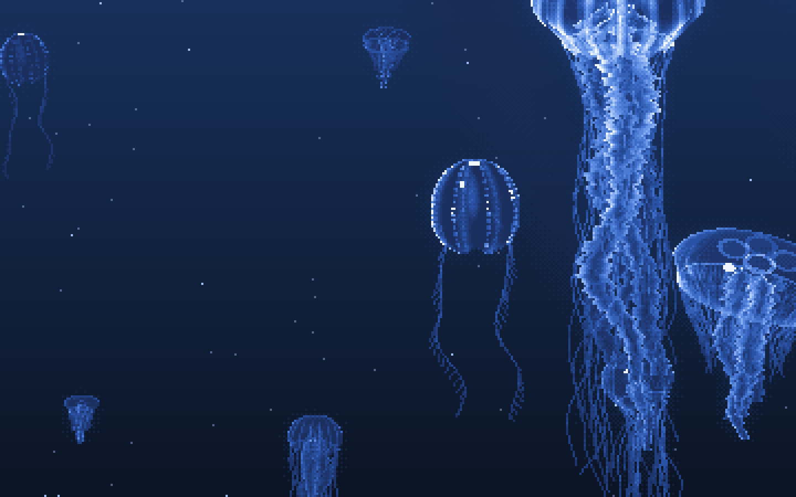
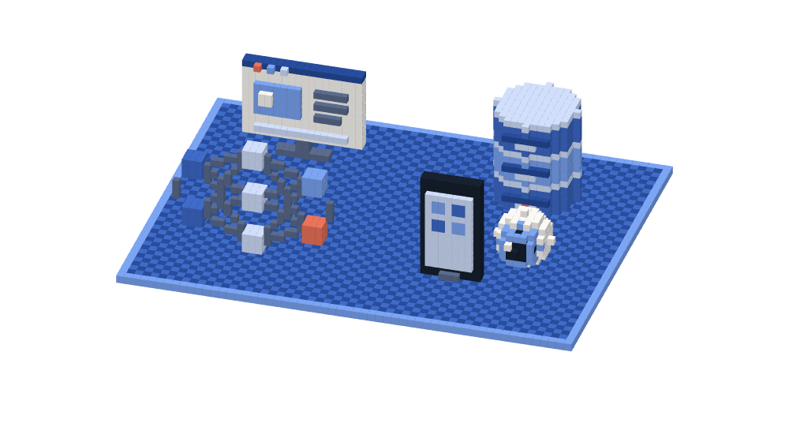
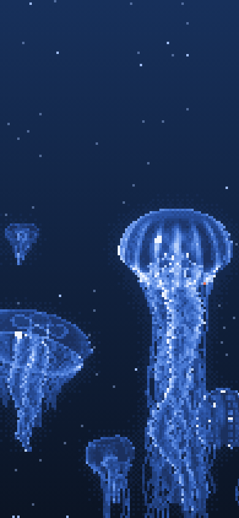
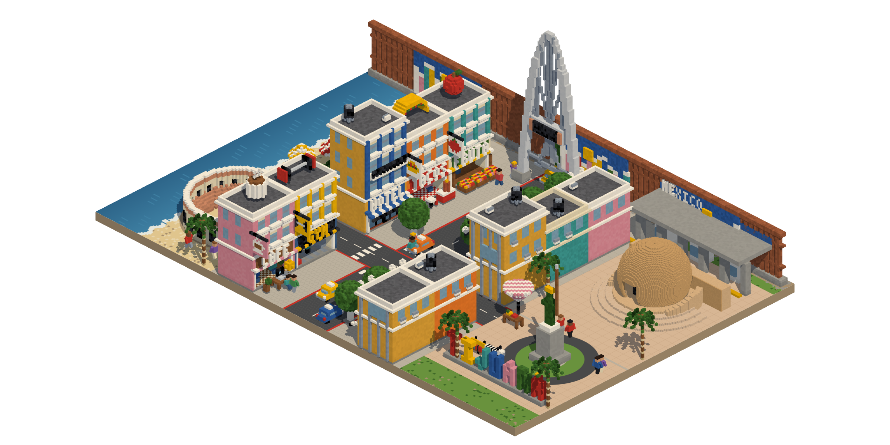
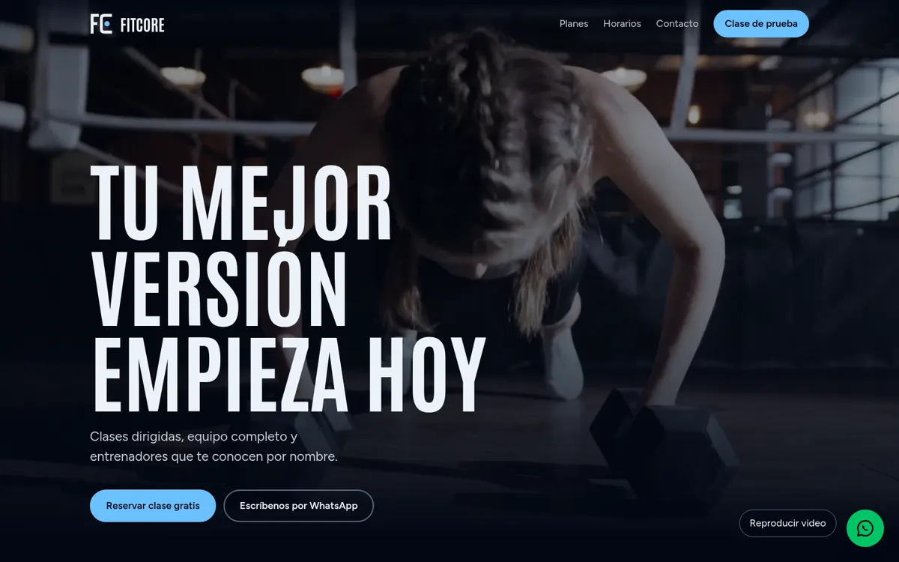
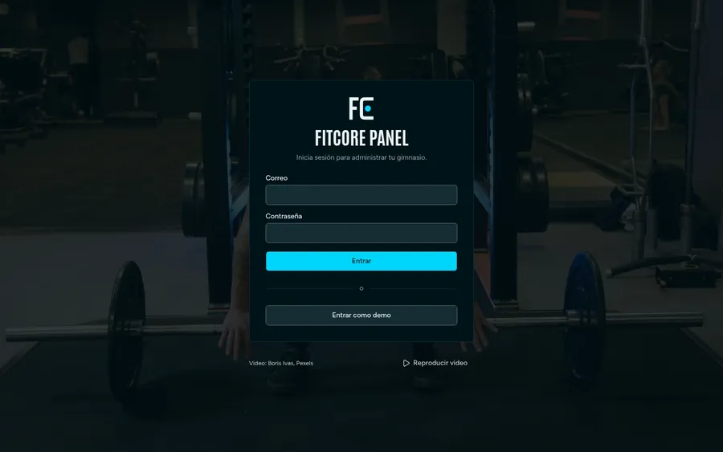

<div align="center">



# Quirelia Studio · Landing page

**Tecnología que conecta tu negocio.**
Sitio web de Quirelia Studio: páginas web, reservas, mensajes automáticos y asistentes con IA para restaurantes, gimnasios y negocios locales.




</div>

## Qué es

Es la landing page bilingüe (español e inglés) de **Quirelia Studio**. Presenta los servicios del estudio, el proceso de trabajo, un cuestionario para orientar al cliente y un formulario de contacto, con una identidad visual propia: una medusa generativa en la portada y escenas *voxel* (estilo cubos) en el resto de las secciones.

Puntos clave:

- **Bilingüe**: contenido en español e inglés (`src/content.ts` y `src/content.en.ts`).
- **Ilustración generativa**: la medusa y los dioramas se dibujan en tiempo real, sin imágenes pesadas.
- **Prerenderizada**: el build genera HTML estático para una carga rápida y buen SEO.
- **Sin contactos inventados**: los datos de contacto salen de un único archivo de configuración y, si están vacíos, la página redirige al formulario.

## Capturas

<table>
  <tr>
    <td width="50%"></td>
    <td width="50%"></td>
  </tr>
  <tr>
    <td align="center"><sub>Diorama voxel</sub></td>
    <td align="center"><sub>Versión móvil</sub></td>
  </tr>
  <tr>
    <td colspan="2"></td>
  </tr>
  <tr>
    <td colspan="2" align="center"><sub>Mapa voxel de Tijuana</sub></td>
  </tr>
  <tr>
    <td></td>
    <td></td>
  </tr>
  <tr>
    <td align="center"><sub>Demo FitCore: landing</sub></td>
    <td align="center"><sub>Demo FitCore: panel</sub></td>
  </tr>
</table>

## Tecnologías

| Área | Herramientas |
| --- | --- |
| Interfaz | [React 19](https://react.dev), [TypeScript](https://www.typescriptlang.org) |
| Gráficos 3D | [Three.js](https://threejs.org) (escenas voxel y mapa) y un motor propio de medusas en canvas |
| Build | [Vite 8](https://vite.dev) con renderizado en servidor (SSR) y prerenderizado |
| Tipografías | Sora, DM Sans y JetBrains Mono (vía [Fontsource](https://fontsource.org)) |
| Calidad | [oxlint](https://oxc.rs/docs/guide/usage/linter) y `tsc` en modo estricto |
| Herramientas | [Bun](https://bun.sh), [Playwright](https://playwright.dev) (capturas del arte) |

## Estructura del proyecto

```text
.
├── public/
│   ├── art/            # Imágenes generadas (portada, dioramas, OG, iconos)
│   └── brand/          # Logo, símbolo, favicon
├── scripts/
│   ├── prerender.ts    # Genera el HTML estático tras el build
│   ├── art.mjs         # Regenera las imágenes de public/art con el motor real
│   └── shot.mjs        # Capturas de pantalla con Playwright
└── src/
    ├── components/     # Secciones y widgets (Contact, Quiz, Process, ...)
    ├── engine/         # Motor de la medusa: campo, especies, paleta
    ├── voxel/          # Modelos, animaciones y escenas voxel (incluye town/)
    ├── config.ts       # Datos de contacto y enlaces del dueño
    ├── content.ts      # Textos en español
    └── content.en.ts   # Textos en inglés
```

## Puesta en marcha

Requisitos: [Bun](https://bun.sh) (el build usa `bun` para el prerenderizado).

```bash
bun install        # instala las dependencias
bun run dev        # servidor de desarrollo en http://localhost:5173
bun run build      # typecheck + build + SSR + prerenderizado
bun run preview    # sirve el resultado del build
bun run lint       # revisa el código con oxlint
```

## Configuración

Los datos de contacto viven en [`src/config.ts`](src/config.ts):

| Clave | Descripción |
| --- | --- |
| `whatsapp` | Número con código de país, solo dígitos (ej. `5216641234567`) |
| `email` | Correo de contacto |
| `formEndpoint` | URL tipo Formspree que acepta un POST en JSON |
| `fitcoreUrl` | Si se define, aparece la sección de demo de FitCore |

La acción principal de la página usa WhatsApp, luego el correo y, si ninguno está definido, el formulario de contacto.

## Regenerar las imágenes

Las ilustraciones de `public/art` y `public/brand` se producen con el mismo motor que usa la página:

```bash
bun run dev        # en una terminal
bun run art        # en otra; opcional: ONLY=hero,diorama para limitar las escenas
```

El script usa un navegador Chromium headless. Indica su ruta con la variable `BROWSER_PATH` si no es la predeterminada.

## Licencia

Software propietario. Todos los derechos reservados © 2026 Quirelia Studio. Consulta el archivo [LICENSE](LICENSE).
