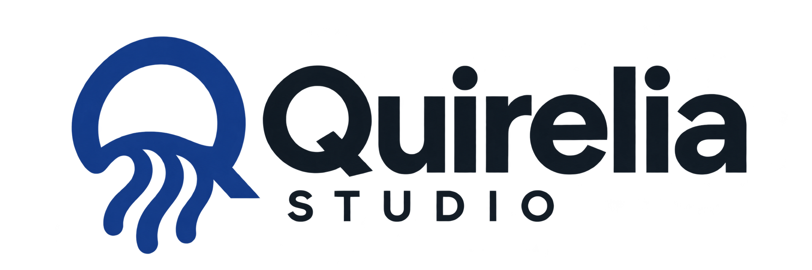
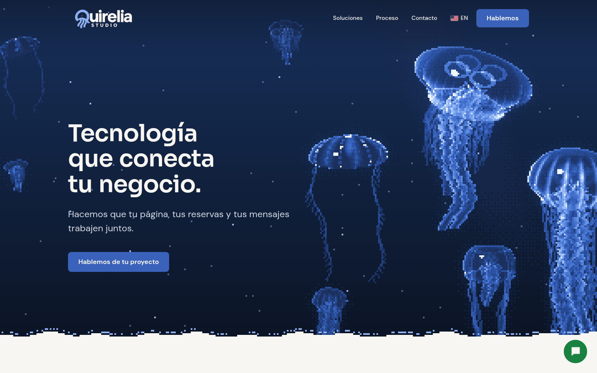
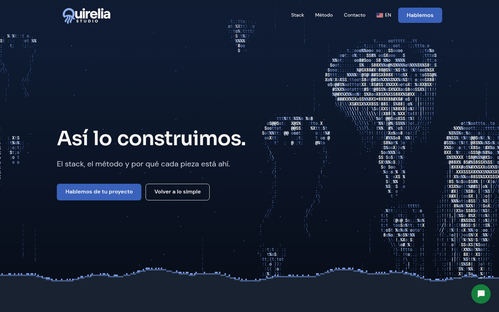
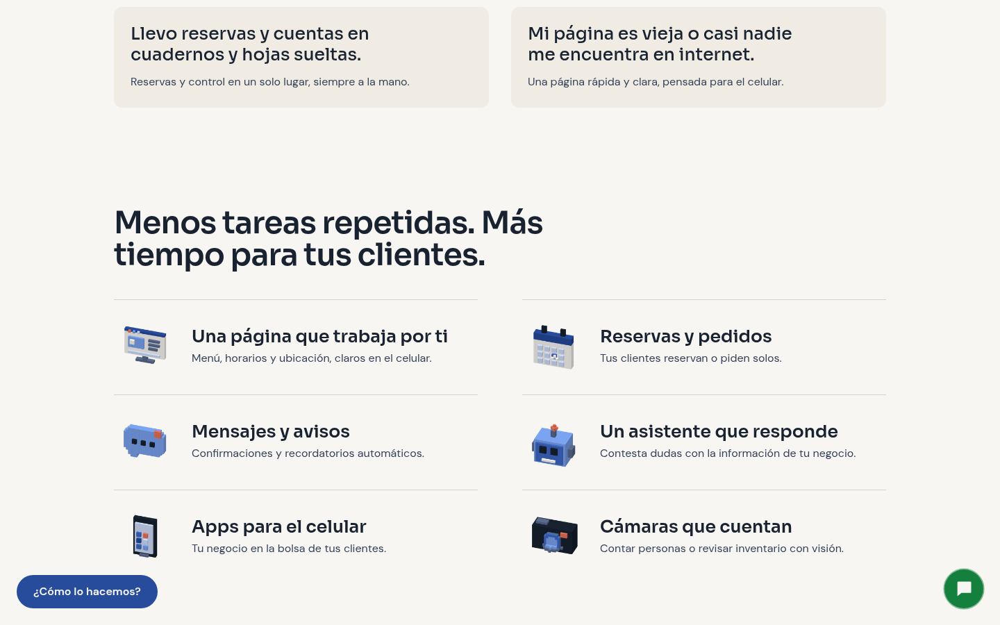
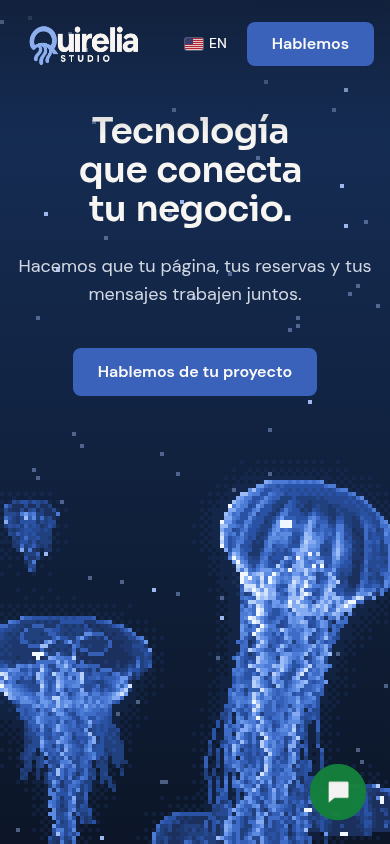
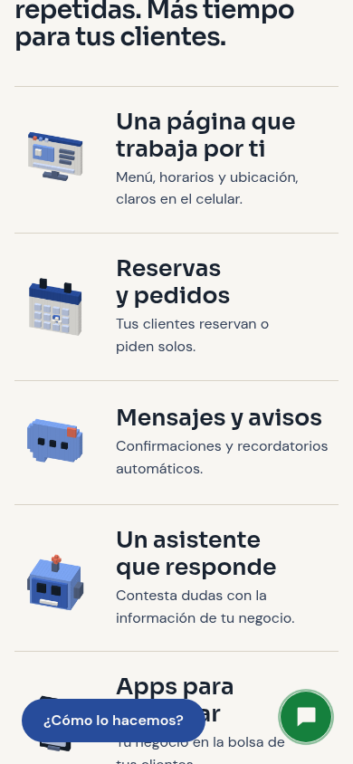
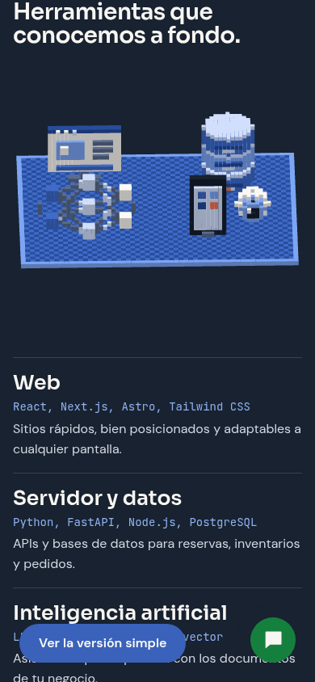

<div align="center">

<picture>
  <source media="(prefers-color-scheme: dark)" srcset="public/brand/logo-light.png" />
  
</picture>

# Quirelia Studio · Landing page

**Tecnología que conecta tu negocio.**

Sitio web bilingüe de Quirelia Studio, un estudio de software de Tijuana, Baja California: páginas web, reservas, mensajes automáticos y asistentes con IA para restaurantes, gimnasios y negocios locales.




</div>

## Descripción

Landing page en español e inglés que presenta los servicios del estudio, su método de trabajo, un cuestionario para orientar al cliente, preguntas frecuentes y un formulario de contacto. La identidad visual gira en torno a una medusa: la portada es un acuario de medusas generadas en tiempo real y el resto de las secciones usan escenas *voxel* (estilo cubos).

### Características

- **Dos modos de lectura.** La misma página se cuenta de forma sencilla para dueños de negocio (modo *negocio*) y de forma técnica para equipos de desarrollo (modo *técnico*, `?modo=tecnico`). Al cambiar, las medusas pasan de pixel art a ASCII.
- **Bilingüe.** Español (`/`) e inglés (`/en/`), con textos separados en `src/content.ts` y `src/content.en.ts`.
- **Ilustración generativa.** Las medusas se dibujan en un motor propio sobre canvas y los dioramas con Three.js: casi no hay imágenes pesadas.
- **Funciona sin JavaScript.** El build prerenderiza el HTML de ambas versiones (SSR), así que el contenido se ve al instante y los buscadores lo leen completo.
- **SEO.** Canonical, `hreflang`, Open Graph y Twitter Cards, datos estructurados JSON-LD (negocio, sitio y FAQ), `sitemap.xml` y `robots.txt` generados en el build.
- **Accesible.** Navegación por teclado, enlace para saltar al contenido, respeto de `prefers-reduced-motion` y texto alternativo para las escenas decorativas.
- **Seguro por defecto.** Cabeceras de seguridad y una política CSP estricta en `public/_headers`.
- **Sin contactos inventados.** WhatsApp, correo y formulario salen de un único archivo de configuración; si faltan, la página lo maneja sin mostrar datos falsos.

## Capturas

### Escritorio

<table>
  <tr>
    <td width="50%"></td>
    <td width="50%"></td>
  </tr>
  <tr>
    <td align="center"><sub>Modo técnico: la portada en ASCII</sub></td>
    <td align="center"><sub>Soluciones, con iconos voxel</sub></td>
  </tr>
</table>

### Móvil

<table>
  <tr>
    <td width="33%"></td>
    <td width="33%"></td>
    <td width="33%"></td>
  </tr>
  <tr>
    <td align="center"><sub>Portada</sub></td>
    <td align="center"><sub>Soluciones</sub></td>
    <td align="center"><sub>Modo técnico</sub></td>
  </tr>
</table>

## Tecnologías

| Área | Herramientas |
| --- | --- |
| Interfaz | [React 19](https://react.dev) y [TypeScript 7](https://www.typescriptlang.org) en modo estricto |
| Build | [Vite 8](https://vite.dev) con renderizado en servidor (SSR) y prerenderizado propio (`scripts/prerender.ts`) |
| Gráficos | [Three.js](https://threejs.org) para las escenas voxel y el mapa; motor propio de medusas sobre canvas 2D |
| Tipografías | Sora, DM Sans y JetBrains Mono, vía [Fontsource](https://fontsource.org) (autoalojadas) |
| Calidad | [oxlint](https://oxc.rs/docs/guide/usage/linter), `tsc` y `bun test` |
| Herramientas | [Bun](https://bun.sh) y [Playwright](https://playwright.dev) (capturas y generación de arte) |
| Despliegue | Sitio estático con cabeceras en `public/_headers` (Netlify, Cloudflare Pages) |

## Estructura del proyecto

```text
.
├── docs/screenshots/   # Capturas del README
├── public/
│   ├── art/            # Imágenes generadas: portada, dioramas, iconos, OG
│   ├── brand/          # Logo, símbolo, favicon
│   ├── _headers        # Caché y cabeceras de seguridad (CSP)
│   └── site.webmanifest
├── scripts/
│   ├── prerender.ts    # HTML estático, JSON-LD, robots.txt y sitemap.xml
│   ├── art.mjs         # Regenera public/art con el motor real
│   └── shot.mjs        # Capturas con Playwright
└── src/
    ├── components/     # Secciones y widgets: Stage, Quiz, Process, Contact...
    ├── engine/         # Motor de medusas: campo, especies, paleta
    ├── voxel/          # Modelos, animaciones y escenas voxel (incluye town/)
    ├── config.ts       # Datos de contacto y enlaces
    ├── content.ts      # Textos en español
    └── content.en.ts   # Textos en inglés
```

## Puesta en marcha

Requisitos: [Bun](https://bun.sh).

```bash
bun install        # instala las dependencias
bun run dev        # servidor de desarrollo en http://localhost:5173
bun run build      # typecheck, build, SSR y prerenderizado
bun run preview    # sirve el resultado del build
bun run lint       # oxlint
bun run test       # pruebas
```

El build **exige** la variable `VITE_SITE_URL` (URL final sin diagonal final): con ella se generan canonical, `hreflang`, `og:image` y el sitemap, y sin ella el build falla. Copia `.env.example` a `.env` y ajústala:

```bash
cp .env.example .env
```

## Configuración

Los datos de contacto viven en [`src/config.ts`](src/config.ts):

| Clave | Descripción |
| --- | --- |
| `whatsapp` | Número con código de país, solo dígitos (ej. `5216641234567`) |
| `email` | Correo de contacto |
| `formEndpoint` | URL tipo Formspree que acepta un POST en JSON |
| `fitcoreUrl` | Si se define, aparece el botón de la demo de FitCore en su sección |
| `sameAs` | Perfiles públicos (LinkedIn, Instagram, GitHub...) para los datos estructurados |

La acción principal de la página usa WhatsApp, luego el correo y, si ninguno está definido, el formulario de contacto.

## Despliegue

`bun run build` deja el sitio estático en `dist/`; súbelo a cualquier hosting estático. `public/_headers` funciona tal cual en Netlify y Cloudflare Pages. Dos detalles de la política CSP:

- El hash `sha256` autoriza el script en línea de `index.html`: recalcúlalo si ese script cambia.
- Si defines `formEndpoint`, añade su origen a `connect-src`.

## Regenerar imágenes y capturas

Las ilustraciones de `public/art` y `public/brand` se producen con el mismo motor que usa la página:

```bash
bun run dev        # en una terminal
bun run art        # en otra; opcional: ONLY=hero,diorama para limitar las escenas
```

Las capturas de `docs/screenshots` se toman con `scripts/shot.mjs`, por ejemplo:

```bash
bun scripts/shot.mjs http://localhost:4173/ docs/screenshots/desktop-hero.png --w 1440 --h 900
```

Ambos scripts usan un navegador Chromium headless; indica su ruta con la variable `BROWSER_PATH` si no es la predeterminada.

## Licencia

Software propietario. Todos los derechos reservados © 2026 Quirelia Studio. Consulta el archivo [LICENSE](LICENSE).
